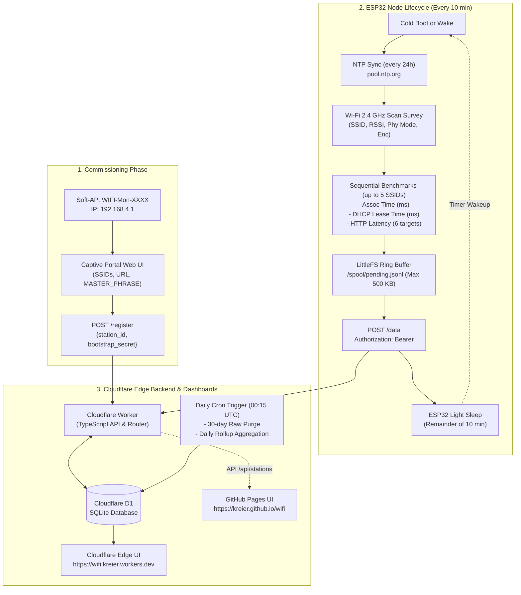

# kreier/wifi

[](https://github.com/kreier/wifi/releases)
[](https://opensource.org/licenses/Apache-2.0)
[](https://wifi.kreier.workers.dev/)
[](https://kreier.github.io/wifi/)

> Autonomous Wi-Fi Spectrum & Latency Telemetry Fleet Node for ESP32 with Cloudflare Worker, D1 SQLite Database, and GitHub Pages.

**Live Telemetry Dashboards**:
- 🌐 **Cloudflare Edge Dashboard**: [https://wifi.kreier.workers.dev/](https://wifi.kreier.workers.dev/)
- 📄 **GitHub Pages Mirror**: [https://kreier.github.io/wifi/](https://kreier.github.io/wifi/)

**Direct Station Access**:
Both the Cloudflare Worker and GitHub Pages support deep-linking directly to specific monitoring stations:
- View Station **9E1-9**: [https://wifi.kreier.workers.dev/9E1-9](https://wifi.kreier.workers.dev/9E1-9) or [https://kreier.github.io/wifi/9E1-9](https://kreier.github.io/wifi/9E1-9)

---

## Evolution from `kreier/T18`

| Architectural Area | Previous `kreier/T18` | Current `kreier/wifi` (`0.4.0`) |
| :--- | :--- | :--- |
| **Telemetry Storage** | Explored direct Git commits / GitHub API pushes | **Cloudflare D1** (Serverless SQLite at edge) with automated 30-day retention and daily rollup summaries ([ADR 0001](docs/adr/0001-d1-over-git-storage.md)) |
| **Device Provisioning** | Manual credential baking or shared keys | **Zero-Trust Token Provisioning**: `MASTER_PHRASE` is erased from Flash and RAM after one-time token exchange ([ADR 0002](docs/adr/0002-per-device-token-provisioning.md)) |
| **Build System** | Separate or monolithic sketches | **Dual-Compatible Architecture**: Single source of modular logic compiled seamlessly by both **PlatformIO** and **Arduino IDE** ([ADR 0003](docs/adr/0003-dual-build-layout.md)) |
| **Power Management** | Continuous active execution | **ESP32 Light Sleep**: Subsystems powered down, RAM retained, wakes via timer or BOOT button |
| **Offline Resilience** | Potential telemetry drop on network failure | **LittleFS Spool Ring Buffer**: Capped at 500 KB FIFO ring buffer (`/spool/pending.jsonl`), preserving records until `200 OK` |
| **Web Frontends** | Static files or GitHub Pages | **Dual Frontends**: Edge-hosted at Cloudflare Workers + Static mirror deployed via GitHub Actions to GitHub Pages, both supporting direct station routing |

---

## Architecture Overview



---

## Repository Structure

```
kreier/wifi/
├── .github/
│   └── workflows/
│       └── deploy-pages.yml  # GitHub Actions workflow deploying to GitHub Pages
├── docs/                     # Static GitHub Pages web files & ADRs
│   ├── index.html            # Standalone responsive web dashboard
│   ├── 404.html              # SPA client router for direct station routes (e.g. /9E1-9)
│   └── adr/                  # Architecture Decision Records
│       ├── 0001-d1-over-git-storage.md
│       ├── 0002-per-device-token-provisioning.md
│       └── 0003-dual-build-layout.md
├── firmware/                 # Dual-compatible firmware source
│   ├── platformio.ini        # PlatformIO targets: t18, devkitv1, t8
│   ├── src/
│   │   └── main.cpp          # PlatformIO compilation entrypoint
│   ├── wifi/
│   │   └── wifi.ino          # Arduino IDE sketch entrypoint
│   └── include/              # Shared modular firmware components
│       ├── app_config.h      # LittleFS config & NVS token management
│       ├── app_main.h        # Top-level state machine & lifecycle
│       ├── app_state.h       # Shared data models & structures
│       ├── api_client.h      # HTTPS /register and /data client
│       ├── board_pins.h      # Compile-time board LED & pin mappings
│       ├── captive_portal.h  # Soft-AP, captive DNS server, & setup UI
│       ├── latency_prober.h  # Association, DHCP, and 6-target HTTP probes
│       ├── led_controller.h  # Non-blocking LED status indicator
│       ├── ntp_sync.h        # SNTP synchronization engine (24h interval)
│       ├── spool_manager.h   # LittleFS ring buffer (500 KB ceiling)
│       └── wifi_scanner.h    # 802.11 b/g/n spectrum analyzer
├── worker/                   # Cloudflare Worker & D1 Backend
│   ├── wrangler.toml         # Worker bindings, D1 config, & cron schedule
│   ├── package.json          # TypeScript & Cloudflare Worker dependencies
│   ├── tsconfig.json         # TypeScript compiler configuration
│   ├── migrations/
│   │   └── 0001_initial_schema.sql # D1 schema: stations, measurements, surveys, daily_summaries
│   └── src/
│       ├── index.ts          # Request router and scheduled event handler
│       ├── types.ts          # Domain interfaces & payloads
│       ├── db.ts             # D1 database query abstraction layer
│       ├── register.ts       # POST /register endpoint handler
│       ├── telemetry.ts      # POST /data telemetry ingestion handler
│       ├── api.ts            # Public GET /api endpoints (stations, details, export)
│       ├── cron.ts           # Daily rollup aggregation & 30-day retention pruning
│       └── frontend.ts       # Responsive single-page dashboard HTML/CSS/JS
├── data/                     # Reserved for future permanent telemetry exports
│   └── .gitkeep
├── LICENSE                   # Apache 2.0 License
└── README.md
```

---

## Hardware Targets & Pinout

Designed for generic ESP32 modules (4 MB Flash, 520 KB SRAM, no external PSRAM required). Three pre-configured environments define board-specific status LED pins:

| Environment | Target Board | Status LED Pin | Default Flag |
| :--- | :--- | :---: | :--- |
| `t18` | **T18 Custom Board** | **GPIO 5** | `-D STATUS_LED_PIN=5` *(Default)* |
| `devkitv1` | **ESP32 DevKit V1** (NodeMCU-32S) | **GPIO 2** | `-D STATUS_LED_PIN=2` |
| `t8` | **T8 ESP32 Board** | **GPIO 21** | `-D STATUS_LED_PIN=21` |

- **BOOT Button**: Standard active-low button on **GPIO 0**.
  - Hold for **3 seconds** at boot or wake to force the device into Captive Portal mode.

---

## Direct Station Routing

Both dashboards support deep-linking directly to a station's real-time metrics and survey:

- **Cloudflare Edge**: `https://wifi.kreier.workers.dev/:station_id` (e.g. [`https://wifi.kreier.workers.dev/9E1-9`](https://wifi.kreier.workers.dev/9E1-9))
- **GitHub Pages**: `https://kreier.github.io/wifi/:station_id` (e.g. [`https://kreier.github.io/wifi/9E1-9`](https://kreier.github.io/wifi/9E1-9))

Switching stations dynamically updates the URL via `history.pushState` without reloading the page.

---

## Zero-Trust Token Provisioning

To prevent secret leakage from physical extraction of flash dumps:
1. Operator inputs `MASTER_PHRASE` (bootstrap secret) into the captive portal.
2. ESP32 connects to Wi-Fi and issues `POST /register`:
   ```json
   {
     "station_id": "9E1-9",
     "description": "Sky Garden",
     "bootstrap_secret": "<MASTER_PHRASE>"
   }
   ```
3. Worker validates `bootstrap_secret === env.MASTER_PHRASE`, generates a cryptographic 32-byte UUID `device_token`, upserts the station in D1, and returns:
   ```json
   { "device_token": "a4f89d32-8419-4b68-b732-23c72b22f180" }
   ```
4. ESP32 saves `device_token` to Non-Volatile Storage (`Preferences`), zeroes out `MASTER_PHRASE` in RAM, and removes it permanently from LittleFS `/config.json`.
5. All future telemetry uses `Authorization: Bearer <device_token>`.

---

## Measurement Engine (10-Minute Cadence)

Every 10 minutes, the probe executes:

1. **24-Hour NTP Sync**: Checks and resynchronizes local time against `pool.ntp.org` once every 24 hours.
2. **Spectrum Survey**: Scans all visible 2.4 GHz BSSIDs recording:
   - SSID (including `<Hidden>`)
   - BSSID (`XX:XX:XX:XX:XX:XX`)
   - RSSI (dBm) & estimated Link Quality % (`clamp(2 * (rssi + 100), 0, 100)`)
   - Encryption (`Open`, `WEP`, `WPA`, `WPA2`, `WPA3`, `WPA2/WPA3`)
   - 802.11 Phy Mode (`WIFI_1` for 11b, `WIFI_3` for 11g, `WIFI_4` for 11n)
   - Channel (1 to 14) and Band (`2.4 GHz`)
3. **Sequential Network Benchmarks** (Up to 5 configured SSIDs):
   - **Association Latency** ($T_{\text{assoc}}$ in ms): Layer 2 connection time.
   - **DHCP IP Acquisition** ($T_{\text{dhcp}}$ in ms): Layer 3 lease assignment time.
   - **HTTP Latency** (3000 ms timeout per target):
     - **Google**: `http://connectivitycheck.gstatic.com/generate_204`
     - **Cloudflare**: `http://cp.cloudflare.com/`
     - **Microsoft**: `http://www.msftconnecttest.com/connecttest.txt`
     - **Facebook**: `http://www.facebook.com/`
     - **Netflix**: `http://fast.com/`
     - **Apple**: `http://captive.apple.com/hotspot-detect.html`
4. **Spool Ring Buffer**: Records are spooled to `/spool/pending.jsonl` (capped at 500 KB FIFO ring buffer).
5. **Telemetry Flush**: Uploads spooled data to `POST /data`. Only after receiving `200 OK` is the spool buffer cleared.
6. **ESP32 Light Sleep**: Subsystems and radio are deactivated; CPU enters light sleep for the remainder of the 600-second window.

---

## Cloudflare Worker & D1 Setup

### 1. Install & Authenticate
```bash
cd worker
npm install
npx wrangler login
```

### 2. Create D1 Database & Run Migrations
```bash
# Create the D1 database
npx wrangler d1 create wifi-mon-db

# Apply schema migrations
npx wrangler d1 migrations apply wifi-mon-db --remote
```

### 3. Set Master Bootstrap Secret
```bash
npx wrangler secret put MASTER_PHRASE
# Enter your secure bootstrap secret
```

### 4. Deploy Worker
```bash
npx wrangler deploy
```

---

## Firmware Build & Flash

### Option A: PlatformIO (Recommended)
```bash
cd firmware

# Build and upload for T18 (LED on GPIO 5)
pio run -e t18 -t upload

# Build and upload for DevKit V1 (LED on GPIO 2)
pio run -e devkitv1 -t upload

# Build and upload for T8 (LED on GPIO 21)
pio run -e t8 -t upload

# Monitor Serial Output
pio device monitor -b 115200
```

### Option B: Arduino IDE
1. Open Arduino IDE 2.x.
2. Open [`firmware/wifi/wifi.ino`](firmware/wifi/wifi.ino).
3. Under **Tools > Board**, select **ESP32 Dev Module**.
4. Set **Partition Scheme** to **Default 4MB with spiffs/littlefs**.
5. Install the **ArduinoJson** library (v7.x) via the Library Manager.
6. Select your target LED pin at the top of `wifi.ino` if not using T18 defaults:
   ```cpp
   #define STATUS_LED_PIN 5  // Pin 5 for T18, 2 for DevKitV1, 21 for T8
   ```
7. Click **Upload**.

---

## API Reference

### `POST /register`
Registers a new station using the bootstrap secret.
- **Request Body**:
  ```json
  {
    "station_id": "9E1-9",
    "description": "Sky Garden",
    "bootstrap_secret": "<MASTER_PHRASE>"
  }
  ```
- **Response `200 OK`**:
  ```json
  {
    "success": true,
    "station_id": "9E1-9",
    "device_token": "d748f220-4f51-4e08-9df8-0d12e6973347"
  }
  ```

### `POST /data`
Submits raw telemetry cycle data.
- **Header**: `Authorization: Bearer <device_token>`
- **Request Body**: Single telemetry object or JSON array of spooled cycles.
- **Response `200 OK`**:
  ```json
  {
    "success": true,
    "station_id": "9E1-9",
    "inserted_measurements": 3,
    "inserted_surveys": 39,
    "cycles_processed": 1
  }
  ```

### `GET /api/stations`
Returns public list of registered stations, their descriptions, and last-seen timestamps.

### `GET /api/station/:id`
Returns detailed station metadata, latest monitored network measurements, visible 2.4 GHz spectrum survey, 24-hour raw history, and 30-day daily rollups.

### `GET /api/export?station_id=:id&format=csv|json`
Downloads recent telemetry for analysis or archival into the `data/` repository directory.

---

## License

This project is licensed under the **Apache License 2.0** — see the [LICENSE](LICENSE) file for details.
