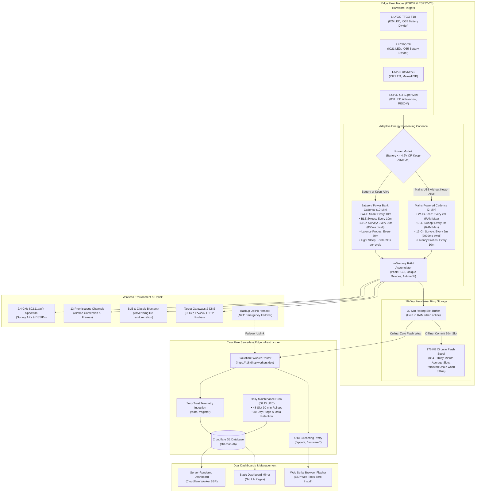

# flynn0/T18

[](https://github.com/flynn0/T18/releases)
[](https://opensource.org/licenses/Apache-2.0)
[](https://t18.dhsp.workers.dev/)
[](https://flynn0.github.io/T18/)

> **Autonomous 2.4 GHz Wi-Fi Spectrum, Network Latency & Bluetooth Fleet Telemetry System** tailored for the **LILYGO TTGO T18** (and fully compatible with **LILYGO T8**, **ESP32 DevKit V1**, and **ESP32-C3 Super Mini**), backed by a serverless Cloudflare Worker, Cloudflare D1 SQLite database, and dual real-time web dashboards.

---

## Quick Navigation

| Resource | URL / Location | Description |
|---|---|---|
| 🌐 **Live Cloudflare Dashboard** | [https://t18.dhsp.workers.dev/](https://t18.dhsp.workers.dev/) | Server-rendered live telemetry, settings, and fleet analytics |
| 📄 **GitHub Pages Mirror** | [https://flynn0.github.io/T18/](https://flynn0.github.io/T18/) | Static client-side dashboard mirror |
| ⚡ **In-Browser Web Flasher** | [https://flynn0.github.io/T18/?flash=1](https://flynn0.github.io/T18/?flash=1) | Zero-install USB flashing via Web Serial API |
| 📦 **GitHub Releases** | [https://github.com/flynn0/T18/releases](https://github.com/flynn0/T18/releases) | Official firmware binaries, merged images, and changelogs |

### Documentation Index
- ⚡ **[Power Consumption & Battery Modeling](docs/power-consumption.md)** — Empirical current measurements, keep-alive pulse derivations, and runtime math.
- ⚙️ **[Firmware Specification](docs/firmware-specification.md)** — Hardware lifecycle, captive setup portal, promiscuous scanning, and OTA architecture.
- 🏗️ **[System Architecture](docs/architecture.md)** — Edge-to-cloud data flow, dual dashboards, and isolate caching layers.
- 🗄️ **[Data Schema & Telemetry](docs/data-schema.md)** — Cloudflare D1 SQLite tables, JSON payloads, and automated 30-day retention.
- ☁️ **[Cloudflare Worker Backend](docs/cloudflare-worker.md)** — Zero-trust bearer authentication, D1 queries, and daily cron maintenance.
- 📊 **[Telemetry Dashboard](docs/dashboard.md)** — 48-slot reliability bars, 24-hour RF heatmaps, and admin console.

---

## System Overview & Architecture



---

## Power Consumption & Battery Autonomy

The firmware is heavily tuned for unattended low-power deployment using **Light Sleep (`esp_light_sleep_start()`)**. The CPU is clock-gated and the radio is powered down between measurement windows, with RAM fully preserved.

### Measured Current Benchmarks

| Hardware Target | Light Sleep Draw | Daily Consumption (10m Cadence) | Average Current | Expected Battery Life |
|---|---|---|---|---|
| **LILYGO TTGO T18** *(LiPo)* | **2.5 mA** | **131.1 – 155.6 mAh / day** | **5.46 – 6.48 mA** | **12.9 – 15.3 days** *(2000 mAh 18650)*<br/>**~19.3 days** *(2500 mAh 18650)* |
| **ESP32-C3 Super Mini** *(Power Bank)* | **1.0 mA** *(1.66 mA eff)* | **83.2 – 100.3 mAh / day** | **3.47 – 4.18 mA** | **62.7 – 75.5 days** *(10,000 mAh 5V Power Bank)* |
| **ESP32 DevKit V1** *(Reference)* | **17.0 mA** *(CP2102 draw)* | **491.8 mAh / day** | **20.49 mA** | **4.1 days** *(2000 mAh LiPo reference)* |

> 📖 **Deep Dive**: Detailed mathematical derivations, pulse duty-cycle formulas, and hardware power models are available in [`docs/power-consumption.md`](docs/power-consumption.md).

### Power Bank Keep-Alive Automatic Switch
- **The Problem**: Standard USB power banks automatically shut off when load drops below $\approx 30\text{--}50\text{ mA}$ for more than 15–30 seconds.
- **The Solution**: On the ESP32-C3, activating the keep-alive setting injects a **120 ms RF probe pulse every 20 seconds**, keeping the power bank alive while adding only **$+0.66\text{ mA}$** to the baseline sleep draw ($1.66\text{ mA}$ effective).
- **Automatic Energy-Preserving Mode**: Because power-bank-powered boards lack direct battery ADC sensing, enabling the keep-alive trigger automatically switches the node to the **10-minute cadence with 800ms survey dwell**, preventing rapid battery depletion.

---

## Offline Data Storage & Retention (18-Day Ring Buffer)

The system is designed to survive extended power outages and network blackouts without losing telemetry:

- **30-Minute Average Invariant**: Both battery-powered and permanently powered nodes store **only consolidated 30-minute average records** in flash.
- **Zero Flash Wear Online**: Intermediate 2-minute and 10-minute measurements accumulate solely in RAM. When internet connectivity is active, telemetry uploads directly from RAM; flash is **never touched**.
- **18 to 31 Days Offline Retention**:
  - The dedicated 176 KB SPI flash circular buffer partition (`spiffs`) stores **864+ thirty-minute average records** ($864 \times 30\text{ min} = 432\text{ hours} = \mathbf{18.0\text{ days}}$ guaranteed).
  - Streamlined binary serialization without verbose AP lists reduces records to ~110–120 bytes, allowing up to **1,500 records (31+ days)** of continuous history.
- **Flash Endurance**: Committing at most 48 writes per day extends NOR flash life to **over 5,700 years**.

---

## Power-Aware Cadence Matrix

| Task | Battery / Power Bank Mode (10m) | Mains Powered Mode (2m) | Operational Details |
|---|:---:|:---:|---|
| **1) Wi-Fi Spectrum Scan** | Every 10 minutes | Every 2 minutes | Discovers active SSIDs, BSSIDs, RSSI, and encryption |
| **2) BLE & Bluetooth Scan** | Every 10 minutes | Every 2 minutes | De-randomizes BLE advertising; counts unique devices |
| **3) 13-Channel Airtime Survey** | Every 30 minutes *(800ms dwell)* | Every 2 minutes *(2000ms dwell)* | Promiscuous frame counting & RF channel contention % |
| **4) Network Latency Probes** | Every 30 minutes *(Visible APs)* | Every 10 minutes *(Visible APs)* | Gateway RTT, DHCP time, DNS, HTTP target latencies |
| **Telemetry Upload Attempt** | Every 10 minutes | Every 10 minutes | Direct from RAM; uploads backlogged flash records if any |
| **Flash Persistence** | Offline only (30-min boundary) | Offline only (30-min boundary) | Zero flash wear during normal online operation |

---

## Hardware Pinout Reference

| Target Board | Status LED Pin | Battery ADC Pin (Divider) | BOOT Button | Default Target |
| :--- | :---: | :---: | :---: | :--- |
| **LILYGO T18** *(Default)* | **GPIO 5** | **GPIO 35** (100k/100k, 0.50f) | **GPIO 0** | `BOARD_T18` |
| **LILYGO T8** | **GPIO 21** | **GPIO 35** (100k/100k, 0.50f) | **GPIO 0** | `BOARD_T8` |
| **ESP32 DevKit V1** | **GPIO 2** | N/A | **GPIO 0** | `BOARD_DEVKIT` |
| **ESP32-C3 Super Mini** | **GPIO 8** *(Active Low)* | N/A | **GPIO 9** | `BOARD_C3_SUPERMINI` |
| **Custom** | Configurable | Configurable | **GPIO 0** | `BOARD_CUSTOM` |

- **Battery Sensing Formula**:
  On both T18 and T8, the battery voltage is measured on **IO35** using the onboard 100kΩ / 100kΩ resistor divider:
  $$V_{\text{battery}} = \frac{V_{\text{ADC}}}{0.50} = 2.0 \times V_{\text{ADC}}$$

---

## Installation & Flashing

### Option A: In-Browser Web Flasher (Zero-Install — Recommended)
Flash pre-compiled universal firmware directly to any ESP32 board over USB using your web browser:

1. **Open the Web Flasher**:
   - 🌐 [https://t18.dhsp.workers.dev/?flash=1](https://t18.dhsp.workers.dev/?flash=1) (Cloudflare Edge)
   - 📄 [https://flynn0.github.io/T18/?flash=1](https://flynn0.github.io/T18/?flash=1) (GitHub Pages Mirror)
   - Or click **⚡ Flash Device** in the top navigation bar of the dashboard.
2. Connect your ESP32 board to your computer with a USB data cable.
3. Supported browsers: **Google Chrome**, **Microsoft Edge**, **Brave**, or **Opera** on desktop.
4. Click **⚡ Connect ESP32 & Install Firmware** and select your board's serial port.
5. Choose **Install T18 Monitor** and check **Erase device** for a fresh installation.
6. The browser downloads the verified binary release, writes all partition tables and application slots, and verifies flash in real-time.

> **Troubleshooting**: If the browser times out synchronizing with the ESP32 chip, press and hold the **BOOT (GPIO 0 / GPIO 9 on C3)** button on your board while clicking Connect, then release it once flashing begins.

---

### Option B: Command-Line Flashing (`esptool.py`)
Download pre-compiled binaries from [GitHub Releases](https://github.com/flynn0/T18/releases/latest):

**Standard ESP32 (Single Unified Binary @ `0x0`)**:
```bash
esptool.py --chip esp32 --baud 921600 write_flash 0x0 firmware-esp32-merged.bin
```

**ESP32-C3 Super Mini (Single Unified Binary @ `0x0`)**:
```bash
esptool.py --chip esp32c3 --baud 921600 write_flash 0x0 firmware-esp32c3-merged.bin
```

---

### Option C: Source Build (PlatformIO)
```bash
cd firmware

# Build and upload for standard ESP32 (T18, T8, DevKit V1)
pio run -e esp32dev -t upload

# Build and upload for ESP32-C3 Super Mini
pio run -e esp32c3 -t upload

# Open Serial Monitor (115200 baud)
pio device monitor -b 115200
```

---

## First Boot & Setup Captive Portal

1. On initial power-up (or holding the BOOT button for >1.5s), the station launches a Wi-Fi Access Point:
   - **SSID**: `T18-Setup-<MAC_SUFFIX>`
   - **Portal IP**: `http://192.168.4.1`
2. Connect with your smartphone or laptop. The configuration portal opens automatically:
   - **Station ID & Location**: Unique name (e.g., `C-103`) and location description.
   - **Monitored Networks**: Configure up to 4 Wi-Fi SSIDs and passwords to benchmark.
   - **Power Bank Keep-Alive**: Enable if powering an ESP32-C3 from an external USB power bank.
   - **Backup Internet**: Configure an emergency failover hotspot (default: `S24`).
3. Click **Save & Reboot**. The node immediately provisions a zero-trust cryptographic bearer token and starts monitoring.

---

## Live Monitoring Dashboards & Admin Features

### 1. Dual Real-Time Dashboards
- **Cloudflare Edge (`https://t18.dhsp.workers.dev`)**: Serverless edge-rendered dashboard backed by Cloudflare D1 with instant two-tier isolate caching.
- **GitHub Pages (`https://flynn0.github.io/T18`)**: Serverless static mirror reading directly from Cloudflare Worker APIs.

### 2. Dashboard Analytics
- **24-Hour Network Reliability Bar (48 × 30-min intervals)**: Color-coded health timeline showing 100% passed (green), HTTP timeout (purple), DNS failure (amber), gateway timeout (orange), DHCP failure (red), or association failure (charcoal).
- **24-Hour Spectrum Heatmap**: Half-hour airtime congestion percentages across all 13 Wi-Fi channels.
- **7-Day BLE Activity Drawer**: Hourly unique Bluetooth device density with dynamic peak color scaling.
- **Discovered AP Catalog**: Live and historical archive of all surrounding APs with signal strength history.

### 3. Settings & Admin Console (`/api/admin/*`)
- Authenticate with administrator credentials to inspect live D1 database sizing, row counts, and 52-week activity heatmaps.
- Update station descriptions, toggle canary OTA release channels, or pin explicit firmware targets.
- Execute timeframe-based telemetry pruning to optimize database storage.

---

## Cloudflare Worker & D1 Deployment

```bash
cd worker
npm install

# Apply database migrations to remote D1
npm run d1:migrate:remote

# Recompile frontend and validate syntax
npm run build:docs

# Deploy to Cloudflare Edge (preserves secrets and passwords)
npx wrangler deploy --keep-vars
```

---

## License

This project is licensed under the **Apache License 2.0** — see the [LICENSE](LICENSE) file for details.
